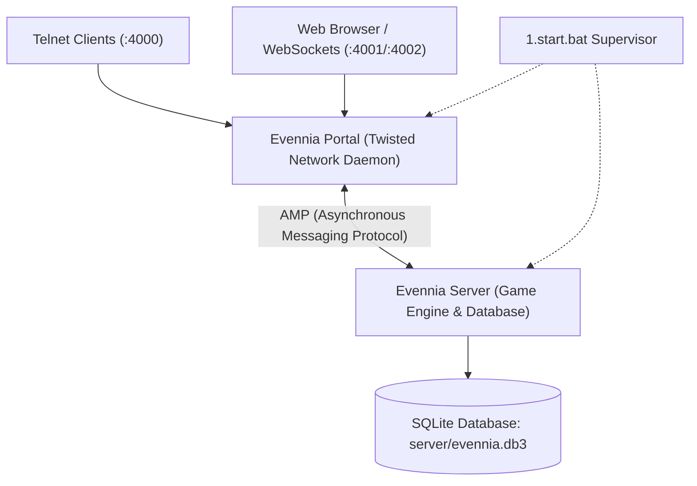
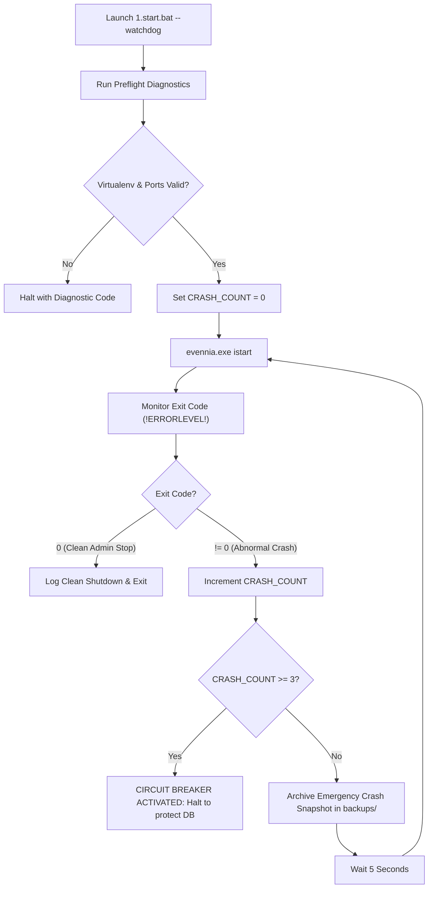

# Eldoria MUD — Evennia Server Operations & Administration Manual

> **Companion Documentation for:** [`C:\Evennia\1.start.bat`](file:///C:/Evennia/1.start.bat)  
> **Server Version:** Evennia 6.1.0  
> **Environment:** Windows Server / Windows 10/11 (PowerShell & Cmd.exe)  
> **Game Directory:** `C:\Evennia\mygame`  
> **Python Virtualenv:** `C:\Evennia\evennia-env`  
> **Backups Directory:** `C:\Evennia\backups`

---

## Table of Contents
1. [Architectural Overview](#1-architectural-overview)
2. [Supervisor Quickstart](#2-supervisor-quickstart)
3. [Interactive Menu Reference](#3-interactive-menu-reference)
4. [Headless CLI Automation & Scheduled Tasks](#4-headless-cli-automation--scheduled-tasks)
5. [Watchdog Daemon & Crash Circuit Breaker](#5-watchdog-daemon--crash-circuit-breaker)
6. [Maintenance Mode & Sentinel Lockfile](#6-maintenance-mode--sentinel-lockfile)
7. [Database Backup & Disaster Recovery](#7-database-backup--disaster-recovery)
8. [Advanced Windows Batch Engineering Details](#8-advanced-windows-batch-engineering-details)
9. [Networking, Ports & Firewalls](#9-networking-ports--firewalls)
10. [Troubleshooting & Diagnostic Matrix](#10-troubleshooting--diagnostic-matrix)

---

## 1. Architectural Overview

Evennia utilizes a dual-process architecture designed for high availability and zero-downtime hot reloads:



### The Two Processes:
1. **The Portal (Twisted Network Daemon):**
   - Listens on external network ports: Telnet (`4000`), HTTP/Webclient (`4001`), and WebSockets (`4002`).
   - Maintains open TCP sockets with all connected players.
   - Forwards inbound user input to the Server process and receives outbound text/GMCP packets from the Server over an internal AMP socket.
   - **Crucial Benefit:** If the Server process reloads or crashes, the Portal keeps all players connected without dropping their client sockets.

2. **The Server (Game Engine Process):**
   - Executes world simulation, commands, combat, languages, sailing, scripts, ticker pools, and GMCP event dispatching.
   - Directly interfaces with the SQLite database file (`server/evennia.db3`).
   - Can be restarted independently of the Portal via `evennia reload`.

### Why the Supervisor Batch File is Required on Windows
Under Windows, background processes and daemonization lack native Unix-like fork/PID supervisors. Improper shutdowns often leave lingering Python processes holding socket locks on ports `4000` or `4001`, or write locks on SQLite database files. 

[`1.start.bat`](file:///C:/Evennia/1.start.bat) acts as an enterprise-grade process supervisor, encapsulating environment activation, socket diagnostics, crash recovery loops, lockfile gating, and instant database archiving.

---

## 2. Supervisor Quickstart

### Launching the Interactive Controller
Open standard Windows Command Prompt or PowerShell, navigate to `C:\Evennia`, and execute:

```bat
cd C:\Evennia
1.start.bat
```

You will be presented with the interactive ASCII controller menu:

```text
===============================================================================
               EVENNIA PRODUCTION SUPERVISOR & CONTROLLER
===============================================================================
  Game Directory:   C:\Evennia\mygame
  Virtualenv:       C:\Evennia\evennia-env
  Documentation:    C:\Evennia\SERVER_OPERATIONS.md
===============================================================================

  [1] Start Server (Standard Background Mode)
  [2] Start Server with Auto-Restart Watchdog (Daemon Mode)
  [3] Graceful Warm Reload (Zero Player Disconnects)
  [4] Graceful Server Shutdown
  [5] Create Instant Database Snapshot (Pre-Flight Backup)
  [6] Pre-Flight Port & Process Conflict Diagnostics
  [7] Toggle Maintenance Mode Lock (.maintenance)
  [8] Tail Live Server Log
  [9] View Operations Documentation
  [Q] Exit Controller

Select management action [1-9, Q]:
```

---

## 3. Interactive Menu Reference

### `[1] Start Server (Standard Background Mode)`
- **Behavior:** Executes `evennia.exe start` in detached background mode after passing pre-flight diagnostics.
- **Use Case:** Everyday development and standard production runs where background operations are preferred.
- **End State:** Both Portal and Server run as independent background processes. The console returns to the supervisor menu.

### `[2] Start Server with Auto-Restart Watchdog (Daemon Mode)`
- **Behavior:** Runs `evennia.exe istart` (interactive foreground start) inside a monitored supervisor loop.
- **Use Case:** Production 24/7 uptime monitoring. Automatically revives the server if an unhandled Python exception, segmentation fault, or OS kill occurs.
- **Circuit Breaker:** If the server crashes 3 consecutive times without stabilizing, the watchdog halts execution to prevent database corruption.

### `[3] Graceful Warm Reload (Zero Player Disconnects)`
- **Behavior:** Invokes `evennia.exe reload`.
- **Use Case:** Applying updates to Python code, commands, typeclasses, or world scripts.
- **Player Impact:** Players experience **zero disconnection**. Their Telnet or Web client socket remains connected to the Portal; the game state pauses for ~1–2 seconds while the Server process reinitializes memory and reconnects to the Portal.

### `[4] Graceful Server Shutdown`
- **Behavior:** Invokes `evennia.exe stop`.
- **Use Case:** Planned system maintenance, hardware reboots, or migrations.
- **Safety Guarantee:** Flushes all unsaved player attributes and tickers to SQLite and closes player connections with polite shutdown notices before terminating processes.

### `[5] Create Instant Database Snapshot (Pre-Flight Backup)`
- **Behavior:** Generates a timestamped replica of `evennia.db3` in `C:\Evennia\backups\evennia_backup_YYYY-MM-DD_HHMMSS.db3`.
- **Safety:** Utilizes Windows WMIC localdatetime parsing to ensure consistent ISO-style timestamps regardless of Windows regional date/time settings.

### `[6] Pre-Flight Port & Process Conflict Diagnostics`
- **Behavior:** Scans ports `4000` and `4001` using `netstat -ano | findstr`. 
- **Remediation:** If dead or orphan Python instances are holding the sockets, prompts with an interactive `[Y/N]` prompt to terminate rogue `python.exe` processes via `taskkill /f /im python.exe`.

### `[7] Toggle Maintenance Mode Lock (.maintenance)`
- **Behavior:** Creates or deletes `C:\Evennia\mygame\server\.maintenance`.
- **Safety Gating:** When present, any startup attempt (Option 1 or 2) halts and displays a critical warning, requiring administrator confirmation before starting the server.

### `[8] Tail Live Server Log`
- **Behavior:** Launches a live PowerShell streaming tail (`Get-Content -Tail 35 -Wait`) on `C:\Evennia\mygame\server\logs\server.log`.
- **Usage:** Press `[Ctrl+C]` to return cleanly to the supervisor menu without stopping the server.

### `[9] View Operations Documentation`
- **Behavior:** Paginates this document (`SERVER_OPERATIONS.md`) directly in the terminal using the Windows `more` filter.

### `[Q] Exit Controller`
- **Behavior:** Quits the supervisor interface. (Background server processes continue running).

---

## 4. Headless CLI Automation & Scheduled Tasks

[`1.start.bat`](file:///C:/Evennia/1.start.bat) includes first-class support for non-interactive automation via CLI flags:

| Flag | Action | Typical Use Case |
|---|---|---|
| `1.start.bat --watchdog` | Boots directly into the Auto-Restart Watchdog loop | OS startup script / Windows Task Scheduler |
| `1.start.bat --reload` | Performs an instant zero-downtime warm reload | Post-Git pull / CI/CD deploy hooks |
| `1.start.bat --stop` | Issues a graceful server shutdown | Automated nightly maintenance |
| `1.start.bat --backup` | Takes a timestamped SQLite snapshot without prompts | Nightly / Hourly cron backup jobs |
| `1.start.bat --check` | Runs pre-flight diagnostics and returns error code | Health check scripts / Monitoring agents |
| `1.start.bat --help` | Displays manual documentation | Quick console reference |

### Example: Windows Task Scheduler Daily Backup Job
To take an automated daily snapshot at 03:00 AM:
1. Open Windows Task Scheduler (`taskschd.msc`).
2. Create Basic Task -> **"Eldoria Nightly Database Backup"**.
3. Trigger: **Daily at 03:00 AM**.
4. Action: **Start a program**.
   - Program/script: `C:\Evennia\1.start.bat`
   - Add arguments: `--backup`
   - Start in: `C:\Evennia`

---

## 5. Watchdog Daemon & Crash Circuit Breaker

### Watchdog Flowchart


### Circuit Breaker Rules
- **Normal Shutdown (`EXIT_CODE == 0`):** Watchdog recognizes administrative stops (`@shutdown` or option 4) and exits cleanly without restarting.
- **Crash (`EXIT_CODE != 0`):** 
  1. Increments `CRASH_COUNT`.
  2. Creates an emergency snapshot in `C:\Evennia\backups\`.
  3. Pauses 5 seconds to allow file handles and sockets to release.
  4. Relaunches `evennia.exe istart`.
- **Threshold Limit:** If 3 crashes occur in succession (`MAX_CONSECUTIVE_CRASHES=3`), the watchdog trips the breaker, prints a critical warning, and halts execution to protect SQLite storage from corruption.

---

## 6. Maintenance Mode & Sentinel Lockfile

The supervisor implements a sentinel lockfile pattern at:  
`C:\Evennia\mygame\server\.maintenance`

### How It Works:
1. When performing database schema migrations (`evennia migrate`), world rebuilds (`evennia py build_world`), or code refactors, toggle option `[7]`.
2. The file `.maintenance` is written to disk.
3. If any administrator or automated service attempts to boot the server (`[1]`, `[2]`, or `--watchdog`), the pre-flight routine detects the lock:
   ```text
   [WARNING] Maintenance lockfile detected at C:\Evennia\mygame\server\.maintenance!
   The server is marked as under maintenance.
   Override lock and proceed anyway? [Y/N]:
   ```
4. This prevents accidental boots while databases or world files are being modified.

---

## 7. Database Backup & Disaster Recovery

### Backup Location
All snapshots are stored in:  
[`C:\Evennia\backups\`](file:///C:/Evennia/backups)  
Naming pattern: `evennia_backup_YYYY-MM-DD_HHMMSS.db3`

### Step-by-Step Disaster Recovery Procedure
If the SQLite database becomes corrupted or a breaking world error occurs:

1. **Stop all running server processes:**
   ```bat
   C:\Evennia\1.start.bat --stop
   ```
2. **Verify no lingering Python processes remain:**
   ```bat
   taskkill /f /im python.exe
   ```
3. **Inspect the backups directory:**
   ```powershell
   Get-ChildItem -Path C:\Evennia\backups\ -Filter *.db3 | Sort-Object LastWriteTime -Descending
   ```
4. **Archive the corrupt file:**
   ```bat
   move C:\Evennia\mygame\server\evennia.db3 C:\Evennia\mygame\server\evennia.db3.corrupt
   ```
5. **Restore the desired snapshot:**
   ```bat
   copy C:\Evennia\backups\evennia_backup_2026-11-05_021500.db3 C:\Evennia\mygame\server\evennia.db3
   ```
6. **Verify database integrity:**
   ```bat
   cd C:\Evennia\mygame
   C:\Evennia\evennia-env\Scripts\evennia.exe check
   ```
7. **Relaunch the server:**
   ```bat
   C:\Evennia\1.start.bat
   ```

---

## 8. Advanced Windows Batch Engineering Details

[`1.start.bat`](file:///C:/Evennia/1.start.bat) incorporates advanced batch scripting techniques to avoid common Windows runtime pitfalls:

### 1. Delayed Variable Expansion (`!ERRORLEVEL!`)
In traditional Windows batch scripting, variables evaluated inside parenthetical blocks (such as `IF (...)` or `FOR (...)`) are bound at parse time rather than execution time. Using standard `%ERRORLEVEL%` inside blocks causes stale return codes to be evaluated.  
The supervisor mandates:
```bat
setlocal enabledelayedexpansion
```
All dynamic execution codes are captured at runtime using `!ERRORLEVEL!`.

### 2. Bulletproof Input Validation with `choice.exe`
Traditional `set /p` prompts in batch are susceptible to crashing when users enter special characters (`<`, `>`, `&`, `|`, `"`).  
[`1.start.bat`](file:///C:/Evennia/1.start.bat) uses the native Windows `choice` utility:
```bat
choice /c 123456789Q /n /m "Select management action [1-9, Q]: "
set "MENU_CHOICE=!ERRORLEVEL!"
```
This restricts input strictly to valid single-keystroke options and guarantees predictable numerical exit codes.

### 3. Locale-Independent Universal Timestamps
Windows `%DATE%` and `%TIME%` strings depend on the host machine's regional locale settings (e.g., `MM/DD/YYYY` vs `DD/MM/YYYY`, 12-hour vs 24-hour clocks, leading spaces on single-digit hours).  
To generate reliable ISO filenames, the script queries Windows Management Instrumentation (WMI):
```bat
for /f "tokens=2 delims==" %%I in ('wmic os get localdatetime /value 2^>nul') do set "LDT=%%I"
set "TS=!LDT:~0,4!-!LDT:~4,2!-!LDT:~6,2!_!LDT:~8,2!!LDT:~10,2!!LDT:~12,2!"
```
This produces `YYYY-MM-DD_HHMMSS` on every Windows system regardless of regional formatting.

---

## 9. Networking, Ports & Firewalls

| Port | Protocol | Service | Description |
|---|---|---|---|
| **4000** | TCP | Evennia Telnet | Standard MUD client access (Mudlet, Tintin++, BlowTorch, raw telnet) |
| **4001** | TCP / HTTP | Evennia Web Server | In-browser web client, admin panel (`/admin`), character pages |
| **4002** | TCP / WebSocket | Evennia WebSocket | Real-time WebSocket connection for modern web clients |
| **AMP** | TCP (Localhost) | Twisted Internal | Internal bridge between Portal daemon and Server game engine |

### Windows Defender Firewall Inbound Rules
If players connect from outside the local machine, ensure Windows Firewall permits traffic on ports 4000–4002:

```powershell
# Run in Administrator PowerShell
New-NetFirewallRule -DisplayName "Eldoria MUD (Telnet 4000)" -Direction Inbound -LocalPort 4000 -Protocol TCP -Action Allow
New-NetFirewallRule -DisplayName "Eldoria MUD (Web 4001)" -Direction Inbound -LocalPort 4001 -Protocol TCP -Action Allow
New-NetFirewallRule -DisplayName "Eldoria MUD (WebSocket 4002)" -Direction Inbound -LocalPort 4002 -Protocol TCP -Action Allow
```

---

## 10. Troubleshooting & Diagnostic Matrix

| Symptom / Error | Root Cause | Solution |
|---|---|---|
| **Error Code `101`** | Virtualenv missing or uninitialized at `C:\Evennia\evennia-env` | Recreate virtual environment: `python -m venv C:\Evennia\evennia-env` and reinstall Evennia. |
| **"Port 4000 or 4001 is already bound"** | Orphan Python process holding socket after unexpected crash | Run Option `[6]` in `1.start.bat` and confirm `[Y]` to terminate orphan Python tasks. |
| **`sqlite3.OperationalError: database is locked`** | Another process is reading/writing to `evennia.db3` | Terminate orphan processes with Option `[6]`. Ensure no external DB browsing tools (e.g. SQLite Browser) hold an uncommitted transaction. |
| **"Maintenance lockfile detected"** | Sentinel file `server\.maintenance` exists | Run Option `[7]` to remove the lockfile after maintenance tasks are finished. |
| **Watchdog trips "CRASH THRESHOLD EXCEEDED"** | Syntax or import error in `mygame/` Python code | Open Option `[8]` (Server Logs) to view traceback. Fix python syntax and test with `evennia check`. |
| **Changes to Python code not taking effect** | Server process has not reloaded code into memory | Execute Option `[3]` (Graceful Warm Reload) or enter `@reload` in-game. |

---

*Manual maintained for Eldoria MUD Operations. For additional Evennia documentation, visit [https://www.evennia.com](https://www.evennia.com).*

