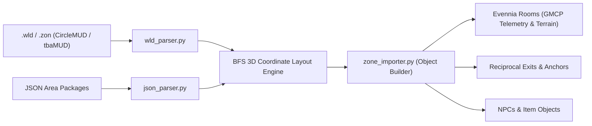

# Eldoria MUD — Automated World & Zone Importer Manual

> **Package Location:** [`C:\Evennia\mygame\world\importers\`](file:///C:/Evennia/mygame/world/importers)  
> **In-Game Command:** `@importzone` (aliases: `@zoneimport`, `@importarea`)  
> **Supported Formats:** CircleMUD / tbaMUD / DikuMUD `.wld` files and Structured JSON packages.

---

## 1. Overview & Capabilities

The World Importer system allows administrators and builders to expand Eldoria by importing zones from the open-source MUD ecosystem.



### Key Features
1. **Multi-Format Ingestion**:
   - **CircleMUD / tbaMUD / Diku `.wld`**: Imports numeric vnums, multiline descriptions, sector types (mapped to Eldoria terrains), and directional exits (`D0`–`D5`).
   - **Structured JSON Packages**: Rich modern format supporting embedded NPCs, items, room titles, descriptions, and custom coordinates.
2. **Automated BFS 3D Coordinate Propagation**:
   - Calculates relative `(x, y, z)` coordinates for every imported room by traversing the exit graph starting from the entrance.
   - Out-of-the-box compatibility with the **GMCP `Room.Info` automapper** in Mudlet, TinTin++, and CMUD.
3. **World Anchoring**:
   - Seamlessly links the imported zone's entrance to an existing room in Eldoria (e.g. connecting a sunken dungeon to `isle_serpent_hollow` or `eldoria_crossroads`), establishing two-way reciprocal exits automatically.
4. **Dry-Run Validation (`/validate`)**:
   - Analyzes zone integrity, room graphs, and dangling exit pointers without modifying the database.
5. **Idempotent Purging (`/purge`)**:
   - Safely removes all rooms, exits, NPCs, and items associated with an imported zone key, allowing clean updates and re-imports.

---

## 2. In-Game Admin Command (`@importzone`)

Builders and Admins can import and manage zones directly from within the game client:

| Command | Description | Example |
|---|---|---|
| `@importzone/help` | Displays command syntax and bundled sample datasets | `@importzone/help` |
| `@importzone/bulk` | Executes master bulk ingestion (3,750+ rooms across 69 realms, fixed danger combat, anchors & transit network) | `@importzone/bulk` |
| `@importzone/validate <path>` | Dry-run check for graph errors, broken links, or syntax issues | `@importzone/validate world/importers/data/praxis_crypts.json` |
| `@importzone/json <path> [anchor] [dir] [retdir]` | Imports a JSON zone and anchors it to an existing room | `@importzone/json world/importers/data/praxis_crypts.json isle_serpent_hollow down up` |
| `@importzone/wld <path> [anchor] [dir] [retdir]` | Imports a CircleMUD `.wld` file and anchors it | `@importzone/wld world/importers/data/sample_midgaard.wld eldoria_crossroads north south` |
| `@importzone/purge <zone_key>` | Deletes all entities belonging to that zone | `@importzone/purge praxis_crypts` |

---

## 3. Bulk Ingested World Expansion (3,759 Rooms Across 69 Major Realms & 15 Transit Routes)

The world of Eldoria has expanded to **3,759+ interconnected rooms** spanning sixty-nine distinct open-source inspired zones, featuring fixed danger levels, complete Nightmare LPmud combat sheets, reciprocal overland/underground anchors, and a 15-vessel/line international maritime/submersible/aether/planar/steam/astral/fey/cloud/coach network:

### 1. The Grand City of Midgaard (CircleMUD / tbaMUD) [Level 1–5]
- **Size:** 35 Rooms
- **Theme:** Classic high-fantasy metropolis with Temple Square, Clerics' Sanctuary, Bazaar, Armory, Thieves' Alley, and High Guard Barracks.
- **Overland Access:** Connected north from `Eldoria North Gate` (`north_gate`) to `Midgaard South Gate`.
- **Maritime Access:** Connected via **The Royal Galleon 'Sea Phantom'** docking at `Midgaard Royal Wharf` (`midgaard_port`).
- **Boss:** *High Templar Valerius* (Level 6 Boss, HP 160).

### 2. The Ironcrag Goblin Mountain & Mines (tbaMUD) [Level 6–11]
- **Size:** 30 Rooms
- **Theme:** Craggy alpine ridge, sentry barricades, iron mining shafts, goblin smelting basins, warrens, and subterranean fungus chasms.
- **Overland Access:** Connected north from `Craggy Foothills` (`foothills`) to `Ironcrag Ridge Mountain Trail`.
- **Boss:** *Chieftain Gornak Ironfang* (Level 12 Boss, HP 280, Spiked Cleaver, 15 Gold).

### 3. The Province & Catacombs of Old Praxis (Nightmare IV) [Level 9–15]
- **Size:** 35 Rooms
- **Theme:** Historic coastal province of Praxis featuring ancient boardwalks, customs houses, academic scribing halls, deep municipal sewers, and flooded catacombs.
- **Overland Access:** Connected west from `Dead Man's Cove` (`dead_mans_cove`) to `Praxis East Coastal Gate`.
- **Maritime Access:** Connected via **The Royal Galleon 'Sea Phantom'** from `Eldoria South Docks` to `Old Praxis Imperial Pier` (`praxis_harbor`).
- **Boss:** *Ghostly Corsair King* (Level 15 Boss, HP 420, Spectral Saber).

### 4. The Shadowfen Necropolis & Mausoleum (CircleMUD) [Level 13–18]
- **Size:** 28 Rooms
- **Theme:** Desolate peat bogs, witch hovels, wrought-iron gates, avenue of weeping angels, and the obsidian Mausoleum of the Black Sun.
- **Overland Access:** Connected north from `The Sunken Mire` (`marshland`) to `Shadowfen Misty Moor`.
- **Boss:** *Arch-Lich Malakor* (Level 19 Boss, HP 750, Necrotic Fireballs, Lich Phylactery).

### 5. The Astral Rifts & Elemental Spires (High-End / DCSS) [Level 18–25+]
- **Size:** 22 Rooms
- **Theme:** Floating astral nexus in zero gravity, shimmering starlight bridge, volcanic Plane of Pyros, oceanic Plane of Aquas, and the cosmic Celestial Spire.
- **Island Access:** Accessible from `Whispering Silt Islet` (`silt_islet`) by typing `enter portal` into `The Astral Nexus Platform`.
- **Endgame Bosses:** *Guardian Archon of Dawn* (Level 23, HP 1400) and *The Astral Overseer* (Level 26, HP 2200, Star-Forged Crown of Sovereignty).

### 6. The Emerald Canopy & Elven Glades of Silvanesti (CircleMUD / Lothlorien) [Level 7–13]
- **Size:** 30 Rooms
- **Theme:** Treetop flets, living vine suspension bridges, master bowyer lofts, sacred moon wells, starlight observatories, and spider hollows.
- **Overland Access:** Head **`east`** from `Deep in the Whispering Woods` (`deep_woods`) into `Ascent to the Emerald Canopy`.
- **Boss Encounter:** *Arch-Druid Faelyn* (Level 13 Boss, HP 280, Moon Well Tears).

### 7. The Great Halls of Khazad-Dum & Deep Magma Forges (tbaMUD Dwarven Kingdom) [Level 14–20]
- **Size:** 30 Rooms
- **Theme:** The Adamantine Doors of Durin, thousand-pillar colonnades, deep mithril mines, imperial vats of iron stout, core magma falls, and the anvil of Durin.
- **Overland Access:** Head **`north`** from `Frostfang Mountain Pass` (`frostfang_pass`) into `The Adamantine Doors of Durin`.
- **Boss Encounters:** *High Thane Thorgar Stoneheart* (Level 18 Boss, HP 600, runed mithril plate) and *The Shadow Demon of the Abyss* (Level 20 Boss, HP 850, Whip of Abyssal Cinders).

### 8. The Shifting Dunes of Kalim Desert & Pyramid of the Sun (CoffeeMUD / CircleMUD) [Level 12–17]
- **Size:** 30 Rooms
- **Theme:** Silk Road caravanserai, shifting dune sea, mirage oases, jackal sphinx avenues, sandstone labyrinth of mirrors, and the golden burial crypt.
- **Overland Access:** Head **`south`** from `The Sunken Bazaar` (`bazaar`) into `The Silk Road Caravanserai`.
- **Boss Encounters:** *Pharaoh Akhen-Ra* (Level 17 Boss, HP 480, Solar Flail) and *Great Sand Dune Worm* (Level 16 Boss, HP 450).

### 9. The Realm of Honshu & Monasteries of the Jade Mountain (Nightmare IV Heritage) [Level 15–22+]
- **Size:** 30 Rooms
- **Theme:** Harbor of the thousand lanterns, bamboo mist groves, cherry blossom tea houses, vermilion torii gates, tiger-style dojos, seven-tier pagodas, and celestial dragon summits.
- **Maritime Access:** Board **The Jade Dragon Junk** from `Eldoria South Docks` or `Old Praxis Pier` to `Honshu Harbor of the Thousand Lanterns`.
- **Boss Encounters:** *Grand Master Kenshin* (Level 21 Boss, HP 750, ki-infused wraps) and *The Celestial Jade Dragon* (Level 25 Boss, HP 1600, Orb of the Jade Dragon).

### 10. The Sunken Metropolis of Atlantea (Lima / FluffOS Deep Sea) [Level 16–23]
- **Size:** 30 Rooms
- **Theme:** The Great Pearl Barrier air-dome, pearl markets, cold-flame coral forges, bioluminescent kelp forests, and the deep kraken trench.
- **Submersible Access:** Board **The Bathysphere 'Nautilus'** from `Eldoria South Docks` or `Dead Man's Cove` diving down to *The Great Pearl Barrier of Atlantea*.
- **Boss Encounters:** *King Triton the Sea Lord* (Level 23 Boss, HP 1000, Trident of Ocean Depths) and *Primordial Abyssal Kraken* (Level 22 Boss, HP 1200).

### 11. The Underdark & Obsidian City of Ched Nasad (CircleMUD / Diku) [Level 18–25]
- **Size:** 30 Rooms
- **Theme:** Chasm of violet faerzress radiation, gates of adamantine webs, stalactite manors, slave bazaars, academy of Sorcere, and the Temple of Lolth.
- **Underground Access:** Descend **`down`** from `The Sunken Ossuary` (`ossuary`) into *Descent to the Faerzress Chasm*.
- **Boss Encounters:** *Matron Mother Malice* (Level 24 Boss, HP 1100, Spider-Fang Rapier) and *Tortured Drider Chieftain* (Level 21 Boss, HP 850).

### 12. Castle Ravencrest & The Vampire Crypts (Gothic Horror / Ravenloft) [Level 14–20]
- **Size:** 30 Rooms
- **Theme:** Creaking drawbridge over misty gorges, weeping gargoyles, ballroom of spectral waltzers, banquet halls of blood-wine, portrait galleries, and the high spire coffin.
- **Mountain Access:** Head **`northeast`** from `Ruined Hilltop Watchtower` (`watchtower`) across *The Drawbridge over Howling Mist*.
- **Boss Encounter:** *Count Vlad von Ravencrest* (Level 20 Vampire Lord Boss, HP 800, Vampiric Signet Ring).

### 13. The Cloud Citadel of the Storm Giants (tbaMUD Elemental Air) [Level 20–27+]
- **Size:** 30 Rooms
- **Theme:** Floating cumulus cloudbanks, bridges of petrified lightning, giant feasting halls, thunderbolt forges, high roc aeries, and the sapphire throne of the stratosphere.
- **Skyward Access:** Ascend to `The Cloud-Piercing Summit` (`summit`) and type **`climb into clouds`** to step onto *The Cloudbank Gateway*.
- **Endgame Boss:** *Storm King Hekaton* (Level 27 Colossus Boss, HP 1600, Thunderbolt Scepter of the Colossus).

### 14. The Steampunk Subterranean City of Cogsmith (Gnomish Tinker Metropolis) [Level 10–16]
- **Size:** 30 Rooms
- **Theme:** Gigantic interlocking house-sized brass gears, pneumatic mail chutes, gyro plazas, volatile naphtha fuel works, clockwork assembly lines, and high horology observatories.
- **Underground Access:** From `Subterranean Rail Hub` (`rail_hub`), type **`board steam tram`** to arrive at *Central Steam-Tram Terminal* (`brass_tram_station`). Type **`disembark tram`** to return.
- **Boss Encounter:** *Grand Mechanist Gearloose* (Level 16 Boss, HP 500, Chronos Pocketwatch of Celerity).

### 15. The Glacial Stronghold of Jötunheim (Nordic Frost Titans) [Level 18–25]
- **Size:** 30 Rooms
- **Theme:** Ice cavern gates carved into blue glaciers, frozen mead halls, mammoth burial grounds, rimeforges, aurora lookouts, blizzard peaks, and the glacial throne.
- **Mountain Access:** From `The Howling Chasm Bridge` (`chasm_bridge`), type **`cross frozen ravine`** to reach *The Ice-Choked Mountain Pass* (`glacial_portal_pass`). Type **`return to bridge`** to return.
- **Mythic Bosses:** *Jarl Thrym the Frost King* (Level 25 Frost Titan Boss, HP 1400, Frost-Hammer of the Glacier King) and *Elder White Dragon* (Level 23 Wyrm Boss).

### 16. The Buccaneer Outlaw Haven of Port Tortuga (Caribbean Pirate Atoll) [Level 8–14]
- **Size:** 30 Rooms
- **Theme:** Weathered ship-plank wharves, singing drunken corsairs, the Salty Siren Tavern, blackstrap rum distilleries, pirate skull caverns, shipwright drydocks, and the Council of Captains.
- **Maritime Access:** Accessible via maritime charter aboard **The Black Skull Corsair Frigate** from *Dead Man's Cove* or *Smuggler's Lagoon*.
- **Boss Encounter:** *Dread Captain Morgan Blood-Eye* (Level 14 Boss, HP 350, Cutlass of Captain Blood-Eye).

### 17. The Iron City of Dis in the Nine Hells of Baator (Infernal Planes) [Level 22–28+]
- **Size:** 30 Rooms
- **Theme:** Streets paved with blistering iron plates, canals of boiling molten lead, halls of blood-signed soul contracts, animated chain bastions, sulfur quarries, flaying spires, and the gargantuan green-veined Iron Tower.
- **Infernal Access:** From `Forgotten Catacombs` (`catacombs`), type **`enter hellfire rift`** to step onto *The Brimstone Portal to Dis* (`infernal_threshold`). Type **`exit hellfire rift`** to return.
- **Plane Lords:** *Arch-Devil Dispater, Lord of the Second* (Level 28 Supreme Arch-Devil Boss, HP 1780, Infernal Rod of Dispater's Iron) and *Pit Fiend Commander* (Level 26 Boss, HP 1250).

### 18. The Primeval Jungle of Chult & Forbidden Ruins of Omu (D&D / Open5e) [Level 12–18]
- **Size:** 30 Rooms
- **Theme:** Dense vine canopy, raptor basins, bubbling tar pits, rope suspension bridges, shrines to the nine trickster gods, flooded royal amphitheater, and the sunken fane of the night serpent.
- **Overland Access:** From `Craggy Foothills` (`foothills`), type **`enter primeval jungle`** to arrive at *The River Olung Estuary* (`river_mouth`). Type **`exit primeval jungle`** to return.
- **Boss Encounters:** *Arch-Lich Acererak* (Level 18 Boss, HP 550, Staff of the Forgotten Gods), *Ras Nsi the Yuan-ti Champion* (Level 17 Boss), and *Tyrannosaurus Zombie* (Level 17 Apex Boss).

### 19. The Necropolis of Anubis & Valley of the Pharaohs (CircleMUD / CoffeeMUD) [Level 15–22]
- **Size:** 30 Rooms
- **Theme:** Avenue of criosphinxes, black basalt pylons, soaring 40-column hypostyle hall, mummification embalming tables, flesh-eating scarab pits, and the grand ascending gallery to the royal pyramids.
- **Desert Access:** From `The Sunken Bazaar` (`bazaar`), type **`venture into valley of pharaohs`** to step onto *The Avenue of Criosphinxes* (`avenue_sphinxes`). Type **`return to sunken bazaar`** to return.
- **Boss Encounters:** *Pharaoh Akhenaten the Sun King* (Level 22 Boss, HP 950, Golden Crook & Flail of Osiris) and *High Priest Imhotep* (Level 20 Solar Archmage Boss).

### 20. The Feywild: Moonlit Court of the Summer Queen (Diku / Lima / Discworld) [Level 16–24]
- **Size:** 30 Rooms
- **Theme:** Gossamer faerie rings, luminescent weeping willow paths, singing quartz brooks, bioluminescent cap dance pavilions, living rose hedge mazes, and the emerald Seelie court.
- **Planar Access:** From `Deep in the Whispering Woods` (`deep_woods`), type **`step through twilight ring`** to enter *The Gossamer Faerie Ring Crossing* (`faerie_ring_crossing`). Type **`step into mortal woods`** to return.
- **Fey Sovereigns:** *Queen Titania the Summer Monarch* (Level 24 Divine Fey Sovereign, HP 1200, Mantle of Eternal Midsummer) and *King Oberon the Shadow Huntsman* (Level 23 Boss, Horn of the Wild Hunt).

### 21. The Abyssal Rift of the Demonweb Pits (Endgame 66th Layer of the Abyss) [Level 24–30 Endgame]
- **Size:** 30 Rooms
- **Theme:** Adamantine web strands suspended over infinity, nurseries of broodweaver demons, screaming soul chasms, marilith blade drills, four-armed glabrezu gatehouses, and the colossal Web Throne.
- **Planar Access:** From `The Sunken Mire` (`marshland`), type **`plunge into abyssal rift`** to reach *The Verge of the Web Chasm* (`web_chasm_verge`). Type **`climb out of abyssal rift`** to return.
- **Supreme Endgame Boss:** *Lolth the Demon Queen of Spiders* (Level 30 Supreme Abyssal God Boss, HP 2400, Silk-Fang Scourge of Chaos) and *Balor General of the Abyss* (Level 28 Boss, HP 1400).

### 22. The Great Sewers & Thieves' Underground of Midgaard (CircleMUD / tbaMUD) [Level 3–8]
- **Size:** 75 Rooms
- **Theme:** Sluggish brick runoff vaults, slime cisterns, wererat burrow warrens, alligator sumps, and the hidden subterranean headquarters of the Shadow Blades thieves' guild.
- **Urban Access:** From `Midgaard Market Square` (`midgaard_district_market_square`), type **`lift iron sewer grate`** to drop into *Iron Sewer Grating Beneath the Market* (`sewer_grate_market`). Type **`climb ladder to market`** to return.
- **Boss Encounters:** *Rat King Splinterclaw* (Level 8 Boss, HP 160, Venomous Stiletto) and *Guildmaster Vane* (Level 9 Boss, HP 190, Shadow Cloak of the Silent Step).

### 23. The Ancient Forest of Haon-Dor & Spider Glen (CircleMUD Classic) [Level 5–11]
- **Size:** 75 Rooms
- **Theme:** Massive gnarled oaks, whispering pine crossroads, hidden forest bandit stockades, web-choked briar hollows, and sacred druidic megalith circles.
- **Wilderness Access:** From `Deep in the Whispering Woods` (`deep_woods`), type **`enter ancient woods of haon-dor`** to step onto *The Western Verge of Haon-Dor* (`haon_dor_western_verge`). Type **`return to whispering woods`** to return.
- **Boss Encounters:** *Bandit Lord Malrik* (Level 11 Boss, HP 240, Malrik's Blood-Forged Greataxe) and *The Arachnid Matriarch* (Level 10 Boss, HP 210, Gossamer Chitin Shield).

### 24. The Haunted Graveyard & Catacomb Crypts of Midgaard (CircleMUD) [Level 6–12]
- **Size:** 75 Rooms
- **Theme:** Fog-shrouded avenue of tombs, royal marble mausoleums, open ghoul trenches, weeping willow plague pits, and subterranean bone ossuaries.
- **Cemetery Access:** From `The Great Temple Square` (`midgaard_district_temple_square`), type **`enter cemetery iron gates`** to arrive at *The Rusted Wrought-Iron Cemetery Gate* (`graveyard_iron_gate`). Type **`return to temple square`** to return.
- **Boss Encounter:** *The Crypt Wight Sovereign* (Level 12 Boss, HP 280, Rime-Forged Wight Blade).

### 25. The Dwarven Kingdom of Moria (Dwarrowdelf & Balin's Tomb) (tbaMUD / Tolkien Classic) [Level 10–18]
- **Size:** 80 Rooms
- **Theme:** Ithildin-glowing Doors of Durin, great stone tree colonnades of Dwarrowdelf, Chamber of Mazarbul records, the narrow chasm bridge, and subterranean mithril mines.
- **Mountain Access:** From `Frostfang Mountain Pass` (`frostfang_pass`), type **`approach doors of durin`** to reach *The West Gate of Moria - Doors of Durin* (`moria_west_gate_durin`). Type **`return to frostfang pass`** to return.
- **Boss Encounters:** *Armored Cave Troll Crusher* (Level 18 Boss, HP 480) and *Balin's Shadow Wraith* (Level 17 Boss, HP 450, Hammer of the Mountain Lord).

### 26. The Sunken Citadel & Twilight Grove (D&D / Open5e Classic) [Level 2–6]
- **Size:** 60 Rooms
- **Theme:** Buried fortress ravines, cracked masonry courtyards, kobold throne rooms, hobgoblin garrisons, and the vampiric Gulthias Tree roots.
- **Ravine Access:** From `Craggy Foothills` (`foothills`), type **`descend into cracked ravine`** to reach *The Ravine Ledge of the Sunken Citadel* (`sunken_citadel_chasm_ledge`). Type **`climb out of cracked ravine`** to return.
- **Boss Encounters:** *Belak the Outcast Druid* (Level 6 Boss, HP 120, Wand of Entangling Briars), *Chieftain Durnn the Hobgoblin* (Level 5 Boss), and *Yusdrayl the Kobold Queen* (Level 4 Boss).

### 27. The High Tower of High Sorcery & Astral Observatory (Dragonlance / CircleMUD) [Level 16–25]
- **Size:** 60 Rooms
- **Theme:** Paralyzing dread of the Shoikan Grove, obsidian and silver gates, infinite libraries of glowing scrolls, elemental summoning crucibles, and the celestial astral orrery.
- **Arcane Access:** From `Ruined Hilltop Watchtower` (`watchtower`), type **`enter grove of shadows`** to step onto *The Shrouded Shoikan Grove* (`tower_sorcery_shoikan_grove`). Type **`exit grove of shadows`** to return.
- **Archmage Boss:** *Archmage Raistlin Majere* (Level 25 Boss, HP 1250, Staff of Magius).

### 28. The Arthurian Realm of Camelot & Mystical Avalon (CircleMUD / Legends) [Level 12–20]
- **Size:** 65 Rooms
- **Theme:** Vibrant jousting tournament meadows, outer barbicans, the Round Table of King Arthur, Merlin's crystal prophecy grotto, and the enchanted Apple Blossom Isle of Avalon.
- **Knightly Access:** From `Eldoria North Gate` (`north_gate`), type **`ride toward camelot`** to arrive at *The Grand Tournament Meadow of Camelot* (`camelot_realm_tournament_meadow`). Type **`ride toward eldoria gate`** to return.
- **Sovereign Bosses:** *King Arthur Pendragon* (Level 20 Boss, HP 780, The Excalibur Blade) and *Merlin the Enchanter* (Level 20 Boss, Oak Wand of Merlin).

### 29. The Sunken Duergar Deep City & Magma Forges (Nightmare IV / Underdark) [Level 15–23]
- **Size:** 65 Rooms
- **Theme:** Obsidian sentry bastions, chained slave quarries, roaring magma forge crucibles, psionic mind flayer embassies, and the Iron Throne of Deep King Horgar.
- **Underground Access:** From `The Adamantine Doors of Durin` (`khazad_deeps_great_gates`), type **`descend into duergar chasm`** to reach *The Obsidian Sentry Bastion* (`duergar_deep_city_obsidian_gate`). Type **`ascend toward dwarven gates`** to return.
- **Deep Tyrants:** *Deep King Horgar Steelshadow* (Level 23 Boss, HP 1050, War-Pick of Deep Earthquakes) and *Elder Brain Ambassador* (Level 21 Boss, Psionic Mind-Shielding Circlet).

### 30. The Temple of Elemental Evil & Elemental Nodes (CircleMUD / D&D Classic) [Level 10–20]
- **Size:** 65 Rooms
- **Theme:** Moathouse ruins, courtyard of the four elemental pillars, greater sanctuary of chaos, fire/water node calderas, and the golden spore sanctum.
- **Swamp Access:** From `The Sunken Mire` (`marshland`), type **`enter ruined moathouse`** to step onto *The Moathouse of the Elemental Eye* (`temple_evil_ruined_moathouse`). Type **`return to sunken mire`** to return.
- **Chaos Bosses:** *Demon Queen Zuggtmoy* (Level 20 Boss, HP 850, Fungal Spore Crown) and *Supreme Cleric Hedrack* (Level 19 Boss, Unholy Mace of the Elemental Eye).

### 31. The Peaceful Shire & Green Dragon Vale (CircleMUD zone 11) [Level 1–5]
- **Size:** 65 Rooms
- **Theme:** Brandywine stone bridge, Green Dragon tavern common room, Bywater watermill, round-doored smial burrows of Bag End, and the Mathom-house museum.
- **Meadow Access:** From `Eldoria North Gate` (`north_gate`), type **`cross brandywine bridge`** to arrive at *The Stone Bridge of the Brandywine* (`shire_brandywine_bridge`). Type **`return to eldoria gate`** to return.
- **Halfling Leader:** *Mayor Will Whitfoot* (Level 4 Boss, HP 75, Clay Pipe & Longbottom Leaf).

### 32. The Sunken Atlantis Upper Shelf & Coral Gardens (Nightmare IV / CoffeeMUD) [Level 14–22]
- **Size:** 65 Rooms
- **Theme:** Iridescent coral shallows, giant clam sanctuaries, merfolk council atriums, electric eel abyssal trenches, and the mother-of-pearl throne.
- **Ocean Access:** From `Dead Man's Cove` (`dead_mans_cove`), type **`dive into coral shallows`** to enter *The Iridescent Coral Shallows* (`coral_shelf_pearl_shallows`). Type **`surface to dead man's cove`** to return.
- **Ocean Empress:** *High Sea Empress Thalassa* (Level 22 Boss, HP 950, Abalone Scepter of Tidal Command).

### 33. The Seven Silver Heavens of Mount Celestia (Planescape / Diku) [Level 20–28]
- **Size:** 65 Rooms
- **Theme:** Pure holy water surf of Lunia's silver sea, mirror-bright platinum gates, golden orchards of Mercuria, and the radiant Empyreal Summit.
- **Celestial Access:** From `The Cloud-Piercing Summit` (`summit`), type **`ascend stairway of silver light`** to reach *The Silver Sea Shore of Lunia* (`celestia_silver_sea_shore`). Type **`descend to mortal summit`** to return.
- **Solar Archangel:** *Archangel Michael the Solar Champion* (Level 28 Boss, HP 1650, Blade of Absolute Justice).

### 34. The Grand Labyrinth of Minos & Cretan Catacombs (Diku / CircleMUD Classic) [Level 8–15]
- **Size:** 72 Rooms
- **Theme:** Cast bronze gate of Daedalus, hall of bronze mirrors, colonnade of petrified gorgon victims, Ariadne's golden thread alcoves, and the central blood altar.
- **Mountain Access:** From `Craggy Foothills` (`foothills`), type **`enter the maze of daedalus`** to step onto *The Bronze Gate of Daedalus* (`labyrinth_minos_bronze_gate`). Type **`escape the labyrinth`** to return.
- **Labyrinth Sovereign:** *Asterion the Minotaur King* (Level 15 Boss, HP 420, Cretan Labrys of the Bull King).

### 35. The City-State of Ankh-Morpork & The Patrician's Palace (Discworld MUD Classic) [Level 6–14]
- **Size:** 72 Rooms
- **Theme:** Brass Bridge riverfront, dangerous alleys of the Shades, Unseen University high library, Treacle Mine Road Watch House, and the Oblong Office.
- **Urban Access:** From `Eldoria North Gate` (`north_gate`), type **`cross onto brass bridge`** to arrive at *The Brass Bridge Wharf of Ankh-Morpork* (`ankh_morpork_brass_bridge_wharf`). Type **`leave brass bridge`** to return.
- **City Rulers:** *Lord Havelock Vetinari* (Level 14 Boss, HP 360, Stiletto of Absolute Tyranny), *Commander Samuel Vimes* (Level 13 Boss, Vimes' Copper City Watch Badge), and *The Librarian* (Level 12 Boss, 'Oook!').

### 36. The Obsidian Dragon Wastes & Wyrm Peak (tbaMUD / CoffeeMUD) [Level 18–26]
- **Size:** 72 Rooms
- **Theme:** Ash-choked cinder defiles, boiling sulfur calderas, dragonkin magma hatcheries, obsidian spire lookouts, and titanic gold hoards.
- **Chasm Access:** From `The Howling Chasm Bridge` (`chasm_bridge`), type **`cross into dragon wastes`** to enter *The Ash-Choked Cinder Pass* (`dragon_wastes_cinder_pass`). Type **`return to howling bridge`** to return.
- **Ancient Wyrm:** *Pyrothrax the Ancient Red Wyrm* (Level 26 Boss, HP 1450, Scale of the Firestorm Dragon).

### 37. The Sunken Cyclopean Ruins of R'lyeh (Nightmare IV / Lovecraftian) [Level 22–30 Endgame]
- **Size:** 72 Rooms
- **Theme:** Non-Euclidean angles of black stone, green slime megaliths, Deep One breeding reefs, star-spawn inquisitors, and the submerged tomb of the cosmic sleeper.
- **Ocean Trench Access:** From `Dead Man's Cove` (`dead_mans_cove`), type **`descend into cyclopean trench`** to reach *The Slime-Encrusted Cyclopean Pylon* (`rlyeh_trench_cyclopean_pylon`). Type **`surface to smuggler's cove`** to return.
- **Cosmic God Boss:** *The Sleeper of R'lyeh* (Level 30 Supreme Endgame Boss, HP 1900, Cosmic Eye of the Star-Spawn) and *Father Dagon Champion* (Level 27 Boss, HP 1300).

### 38. The Tomb of Horrors & Acererak's Demilich Crypt (Gary Gygax S1 / D&D) [Level 20–28 Endgame]
- **Size:** 60 Rooms
- **Theme:** Lethal trap gauntlets, false entrances, mosaic paths of floating spheres, the gaping maw of the Great Green Devil, shifting gravity chambers, and the gem-studded demilich altar.
- **Catacomb Access:** From `Forgotten Catacombs` (`catacombs`), type **`descend into the tomb of horrors`** to reach *The False Entrance of the Tomb of Horrors* (`tomb_of_horrors_tomb_entrance_false_portal`). Type **`ascend from the tomb of horrors`** to return.
- **Endgame Boss:** *Acererak the Demilich* (Level 28 Supreme Boss, HP 1780, Acererak's Jeweled Demilich Skull, Staff of the Archmage's Ruin).

### 39. The City of Brass & Elemental Plane of Fire (Planescape / Arabian Nights) [Level 18–26 Planar]
- **Size:** 60 Rooms
- **Theme:** Basalt quays over boiling seas of fire, gates of molten bronze, efreet spice souks, salamander armories, and the imperial throne of burning basalt.
- **Planar Access:** From `The Howling Chasm Bridge` (`chasm_bridge`), type **`step through planar fire portal`** to reach *The Obsidian Pier of the Sea of Fire* (`city_of_brass_city_of_brass_obsidian_pier`). Type **`step through planar portal to mortal realm`** to return.
- **Planar Sovereign Boss:** *Grand Sultan Al-Malik of the Smoldering Throne* (Level 25 Boss, HP 1600, Scimitar of the Efreet Sultan, Smoldering Brass Censer of Flame Control).

### 40. The Dwarven Citadel of Mithral Hall (R.A. Salvatore / Forgotten Realms) [Level 12–20]
- **Size:** 60 Rooms
- **Theme:** Secret glacial valley portals, towering pillar halls of clan Battlehammer, Garumn's Gorge and sheer catwalk spans, radiant mithral veins, and the subterranean shadow dragon lair.
- **Mountain Defile Access:** From `Frostfang Mountain Pass` (`frostfang_pass`), type **`enter secret dwarf passage to mithral hall`** to reach *The Secret Valley Gates of Clan Battlehammer* (`mithral_hall_mithral_hall_valley_gates`). Type **`exit mithral hall to frostfang pass`** to return.
- **Shadow Dragon Boss:** *Shimmergloom the Shadow Dragon* (Level 22 Boss, HP 1420, Mithral Warhammer of the Battlehammer Thane, Aegis-fang of the North).

### 41. The Sunken Trench of the Kraken & Triton Coral Citadel (Aquatic Abyss) [Level 18–26]
- **Size:** 60 Rooms
- **Theme:** Plunging continental oceanic rifts, hydrothermal black smokers, mother-of-pearl triton throne rooms, crushed corsair galleon graveyards, pulsing siphonophore forests, and the crushing trench lair of the leviathan.
- **Abyssal Ocean Access:** From `Dead Man's Cove` (`dead_mans_cove`), type **`dive into the midnight abyss trench`** to reach *The Abyssal Rim of the Midnight Trench* (`kraken_trench_kraken_trench_abyssal_rim`). Type **`surface from the deep abyssal trench`** to return.
- **Oceanic Titan Boss:** *The Ancient Kraken Leviathan* (Level 24 Boss, HP 1540, Trident of the Abyssal Leviathan, Black Pearl of Tidal Mastery).

### 42. The Astral Dreadnought & Githyanki Sky-Citadel (Planescape / Astral Plane) [Level 20–28 Planar]
- **Size:** 60 Rooms
- **Theme:** Weightless thought-matter wharves, ossified dead god ribcage colonnades, astral red dragon knight barracks, telepathic inquisitor halls, and the dread chasm of the slumbering astral dreadnought.
- **Planar Void Access:** From `The Cloud-Piercing Summit` (`summit`), type **`step into astral silver void`** to reach *The Silver Void Wharf of Tu'narath* (`astral_dreadnought_astral_silver_wharf`). Type **`return through astral portal to summit`** to return.
- **Githyanki Warmaster Boss:** *Vlaakith's Inquisitor-General Val'keth* (Level 27 Boss, HP 1720, Githyanki Silver Greatsword of Astral Severance, Crown of the Dead God).

### 43. The Sunken City of Omu & Fane of the Night Serpent (Tomb of Annihilation / Chult) [Level 16–24]
- **Size:** 60 Rooms
- **Theme:** Choked Chultan jungle vine ruins, flooded viper sacrificial pits, yuan-ti malison brood chambers, blood fountains of Dendar, and the serpent throne of the undead hierophant.
- **Swamp Mire Access:** From `The Sunken Mire` (`marshland`), type **`descend into sunken serpent fane`** to reach *The Sunken Gateway of Ancient Omu* (`fane_night_serpent_omu_ruined_gateway`). Type **`surface from serpent fane to sunken mire`** to return.
- **Serpentine Warlord Boss:** *Ras Nsi the Yuan-ti High Hierophant* (Level 24 Boss, HP 1540, Flame Tongue Scimitar of Ras Nsi, Serpent Eye Amulet of Poison Mastery).

### 44. The Frozen Glacier Spire of Svardborg (Storm King's Thunder / Arctic) [Level 16–25]
- **Size:** 60 Rooms
- **Theme:** Solid permafrost docks, towering blue ice rifts, winter wolf kennels, war mammoth stables, wrecked cog longhouses, and the colossal true-ice throne of the frost giant king.
- **Glacial Crest Access:** From `Ruined Hilltop Watchtower` (`watchtower`), type **`ascend frozen glacial crest to svardborg`** to reach *The Frozen Pier of Svardborg Glacier* (`svardborg_glacier_svardborg_glacier_pier`). Type **`descend glacier to ruined watchtower`** to return.
- **Frost Giant Sovereign Boss:** *Jarl Storvald the Frost Giant King* (Level 25 Boss, HP 1600, Greataxe of Permafrost, Horn of the Blinding Blizzard).

### 45. The Cursed Shadowfell Necropolis of Moil (Return to the Tomb of Horrors / Shadowfell) [Level 22–30 Endgame]
- **Size:** 60 Rooms
- **Theme:** Suspended iron chain spans over the necrotic void, supernatural black ice colonnades, inverted hollow spires of sundered skies, weeping vestige sarcophagi, and the levitating throne of the void arch-lich.
- **Necrotic Void Access:** From `The Sunken Ossuary` (`ossuary`), type **`cross chained void bridge into moil`** to reach *The Chained Span of Moil* (`shadowfell_moil_moil_chain_bridge_entry`). Type **`return across void bridge to sunken ossuary`** to return.
- **Void Sovereign Boss:** *Malchor the Sovereign of Moil* (Level 29 Supreme Boss, HP 1840, Black Ice Scythe of Moil, Vestige of the Sundered Void).

### 46. The Drow Metropolis of Menzoberranzan (Forgotten Realms Underdark) [Level 16–25]
- **Size:** 60 Rooms
- **Theme:** Sprawling subterranean stalactite palaces, warded gates of Tier Breche, Arach-Tinilith spider academy, House Baenre compounds, Narbondel thermal clock pillar, and Donigarten fungal shores.
- **Underdark Rift Access:** From `Subterranean Rail Hub` (`rail_hub`), type **`descend underdark rift to menzoberranzan`** to reach *The Warded Gates of Tier Breche* (`menzoberranzan_menzo_tier_breche_gates`). Type **`ascend subterranean rift to rail hub`** to return.
- **Drow Matron Boss:** *Matron Mother Quenthel Baenre* (Level 26 Boss, HP 1660, Scourge of the Spider Queen, Insignia of House Baenre).

### 47. The Floating Cloud Castle of Skyreach (Hoard of the Dragon Queen / High Altitude) [Level 18–26]
- **Size:** 60 Rooms
- **Theme:** Floating citadel carved of cloudstone and permanent ice, soaring open-air balconies, true-ice caverns of the white dragon Glazhael, steering control orb, and the throne hall of Count Blagothkus.
- **Mountain Summit Access:** From `The Cloud-Piercing Summit` (`summit`), type **`board floating cloud dock of skyreach`** to reach *The Floating Cloud Dock of Skyreach Castle* (`skyreach_castle_skyreach_castle_cloud_gate`). Type **`descend cloud stairway to mountain summit`** to return.
- **Cloud Giant Sovereign Boss:** *Blagothkus the Cloud Giant Count* (Level 25 Boss, HP 1600, Morningstar of the Cloud Giant, Control Orb of Skyreach Castle).

### 48. The Sunken Elven Ruins of Myth Drannor (Ruins of Myth Drannor / High Magic) [Level 15–24]
- **Size:** 60 Rooms
- **Theme:** Shattered elven mythal gates, silver divination pools of the Speculum, overgrown Coronal palaces, baelnorn vaults, and the subterranean breach of the aberration despoilers.
- **Forest Portal Access:** From `Deep in the Whispering Woods` (`deep_woods`), type **`pass through elven mythal portal`** to reach *The Shattered Mythal Gate of Myth Drannor* (`myth_drannor_myth_drannor_ancient_mythal_gate`). Type **`return through mythal portal to deep woods`** to return.
- **Aberration Boss:** *The Eldritch Phaerimm Despoiler* (Level 24 Boss, HP 1540, Moonblade of the Coronal, Shard of the Shattered Mythal).

### 49. The Nine Hells — City of Dis & The Iron Tower (Planescape / Baator) [Level 22–30 Endgame]
- **Size:** 60 Rooms
- **Theme:** Red-hot iron city gates, streets paved with boiling slag, erinyes aerie executioners, shifting mirrors of paranoia, and the shifting iron throne of Archduke Dispater.
- **Infernal Gate Access:** From `The Sunken Bazaar` (`bazaar`), type **`step through infernal gate into dis`** to reach *The Scorched Iron Gate of Dis* (`hells_dis_iron_tower_dis_iron_gate_of_chains`). Type **`escape burning iron city to sunken bazaar`** to return.
- **Archduke of Hell Boss:** *Archduke Dispater of the Iron Tower* (Level 29 Supreme Boss, HP 1840, Iron Rod of Archduke Dispater, Signet Ring of the Nine Hells).

### 50. The Chasm of the Abyss & Royal Wood of Oolacile (Dark Souls / Primeval Dark) [Level 20–28 Endgame]
- **Size:** 60 Rooms
- **Theme:** Primordial darkness slopes, bloathead sorcerer hollows, overgrown stone colosseums, humanity sprite swarms, and the sorrowful bed of the Primeval Man.
- **Catacomb Access:** From `Forgotten Catacombs` (`catacombs`), type **`pass into abyss rift of oolacile`** to reach *The Sanctuary Garden Gate of Oolacile* (`abyss_oolacile_oolacile_sanctuary_garden_gate`). Type **`return from oolacile to catacombs`** to return.
- **Primeval Abyss Boss:** *Manus, Father of the Abyss* (Level 28 Supreme Boss, HP 1780, Soul of Manus, Father of the Abyss, Manus's Craggy Sorcery Catalyst).

### 51. The Gnomish Clockwork Metropolis of Lantan (Forgotten Realms / Steampunk) [Level 12–20]
- **Size:** 60 Rooms
- **Theme:** Pneumatic transit hubs, Gondar gear foundries, smokepowder arsenals, giant planetarium astrolabes, and the mechanical laboratory of the master gearsmith.
- **Pneumatic Rail Access:** From `Subterranean Rail Hub` (`rail_hub`), type **`board pneumatic express to lantan`** to reach *The Grand Pneumatic Rail Terminal* (`clockwork_lantan_lantan_pneumatic_rail_terminal`). Type **`board return train to rail hub`** to return.
- **Master Artificer Boss:** *Grand Artificer Beldon the Gearsmith* (Level 22 Boss, HP 1420, Smokepowder Thunder-Arquebus, Gears of the Great Clockwork Cosmos).

### 52. The Githzerai Floating Monasteries of Limbo (Planescape / Limbo) [Level 18–26 Planar]
- **Size:** 60 Rooms
- **Theme:** Stabilized granite island rims adrift in elemental chaos, Unbroken Circle pebble gardens, slaad spawning crevasses, telekinetic dojos, and Zerthimon's wisdom libraries.
- **Summit Portal Access:** From `The Cloud-Piercing Summit` (`summit`), type **`step into churning chaos of limbo`** to reach *The Stabilized Island Rim of Shra'kt'lor* (`limbo_monasteries_limbo_chaos_island_rim`). Type **`return through githzerai portal to summit`** to return.
- **Anarch Psionic Boss:** *Supreme Zerth Anarch Zaer* (Level 25 Boss, HP 1600, Unbroken Circle of Zerthimon, Robes of the Supreme Anarch).

### 53. The Buried Netherese Necropolis of Ythryn (Icewind Dale / Ancient Magic) [Level 22–30 Endgame]
- **Size:** 60 Rooms
- **Theme:** Vertical permafrost shafts, inverted spires of the Eight Arcane Schools, floating crystal mythallars, containment halls of living spells, and the demilich sanctum.
- **Glacier Shaft Access:** From `Frostfang Mountain Pass` (`frostfang_pass`), type **`descend glacial shaft into ythryn`** to reach *The Glacial Shaft into Ythryn* (`ythryn_necropolis_ythryn_glacier_shaft_entrance`). Type **`ascend ice shaft to frostfang pass`** to return.
- **Ancient Netherese Boss:** *Iriolarthas the Netherese Demilich* (Level 29 Supreme Boss, HP 1840, Nether Scroll of Absolute Magic, Crown of Netheril).

### 54. The Sunken City of Atlantis & Poseidon's Trench (Mythic Deep Sea) [Level 18–26]
- **Size:** 60 Rooms
- **Theme:** Submerged mother-of-pearl triumphal arches, vibrant coral colonnades, bioluminescent algae terraces, hydrothermal magma chimneys, and the skull-carved kraken throne.
- **Abyssal Trench Access:** From `Dead Man's Cove` (`dead_mans_cove`), type **`dive into abyssal trench towards atlantis`** to reach *The Pearly Archway of Sunken Atlantis* (`sunken_atlantis_atlantis_pearly_archway`). Type **`ascend ocean current back to dead mans cove`** to return.
- **Oceanic Boss:** *King Amphitrite of the Deep Trench* (Level 28 Boss, HP 1780, Trident of the Ocean Lord, Crown of Atlantis).

### 55. The Radiant Solar Spire of Mount Celestia & Lunia's Shore (Seven Heavens / Planar) [Level 20–28]
- **Size:** 60 Rooms
- **Theme:** Holy powdered pearl shores of the Silver Sea, platinum bridges spanning golden cloud chasms, heraldic trumpet archon terraces, and the pinnacle of pure solar starlight.
- **Holy Beam Access:** From `Cathedral of the Radiant Dawn` (`cathedral`), type **`ascend holy light beam to mount celestia spire`** to reach *The Silver Sea Shore of Lunia* (`celestia_spire_celestia_spire_silver_shore`). Type **`descend crystal steps back to cathedral`** to return.
- **Celestial Archon Boss:** *Archon Lord Raziel* (Level 28 Boss, HP 1780, Platinum Blade of Truth, Halo of Solar Grace).

### 56. Sigil, City of Doors & The Hive Ward (Planescape Planar Hub) [Level 16–25]
- **Size:** 60 Rooms
- **Theme:** The donut-torus floating over the Spire, razorvine-choked tenements, Smoldering Corpse Bar, Dustmen Mortuary, Hall of Speakers, and the silent shadow of the Lady of Pain.
- **Planar Gateway Access:** From `Eldoria Grand Plaza` (`plaza`), type **`step through shimmering door-portal into sigil`** to reach *The Torus Gateway of Sigil* (`sigil_doors_sigil_doors_portal_gateway`). Type **`step through exit arch back to grand plaza`** to return.
- **Lady's Factotum Boss:** *High Dabus Factotum of the Lady* (Level 27 Boss, HP 1720, Spire Key of the Infinite Doors, Whip of Razorvine Tendrils).

### 57. The Primordial Fire Realm of Muspelheim & Surtr's Iron Smelters (Norse Myth / Fire Plane) [Level 22–30 Endgame]
- **Size:** 60 Rooms
- **Theme:** Black basalt causeways suspended over roaring rivers of liquid slag, fire giant blast smelters, cinder drake roosts, obsidian anvils, and the world-burning throne of Surtr.
- **Molten Causeway Access:** From `The Obsidian Pier of the Sea of Fire` (`city_of_brass_obsidian_pier`), type **`cross bridge of molten slag into muspelheim`** to reach *The Great Basalt Causeway of Muspelheim* (`muspelheim_forge_muspelheim_basalt_bridge`). Type **`retreat across basalt bridge back to city of brass`** to return.
- **Primordial Fire King Boss:** *Surtr, King of Fire Giants* (Level 30 Supreme Boss, HP 1900, Twilight Blade of Surtr, Crown of Muspelheim Cinders).

### 58. The Clockwork Nirvana of Mechanus & Modron Cathedral (Planescape / Axiomatic Law) [Level 18–26]
- **Size:** 60 Rooms
- **Theme:** Endless planetary interlocking brass cogs, frictionless mercury lubrication vats, Marut judgment halls, and the reverberating Modron Cathedral.
- **Interlocking Gear Access:** From `Subterranean Rail Hub` (`rail_hub`), type **`step into interlocking gear portal to mechanus`** to reach *The Planetary Gear Platform of Mechanus* (`mechanus_gears_mechanus_planetary_gear_platform`). Type **`step off planetary gear back to subterranean rail hub`** to return.
- **Lord of Modrons Boss:** *Primus, Lord of the Modrons* (Level 28 Boss, HP 1780, Infinity Gear of Primus, Axiomatic Scepter of Law).

### 59. The Feywild Summer Court & Palace of Queen Titania (Feywild / Nature) [Level 16–24]
- **Size:** 60 Rooms
- **Theme:** Iridescent willow groves, glowing clover paths, dancing satyr orchards, gossamer rose gates, and the living flower bower of the Summer Queen.
- **Fey Archway Access:** From `Deep in the Whispering Woods` (`deep_woods`), type **`pass through whispering willow archway into summer court`** to reach *The Emerald Gateway of the Summer Court* (`summer_court_summer_court_emerald_gateway`). Type **`return through willow arch back to deep woods`** to return.
- **Archfey Sovereign Boss:** *Queen Titania of the Summer Court* (Level 26 Boss, HP 1660, Crown of the Summer Solstice, Bow of Fey Starlight).

### 60. The Shadowfell Fortress of Memories & Raven Queen's Sanctuary (Shadowfell / Doom) [Level 22–30 Endgame]
- **Size:** 60 Rooms
- **Theme:** Black obsidian battlements, Sorrowsworn hollows, crystal memory urn vaults, reflecting pools of inevitable mortality, and the throne of black ice.
- **Shadow Rift Access:** From `The Sunken Ossuary` (`ossuary`), type **`pass into shadow rift towards fortress of memories`** to reach *The Obsidian Gates of the Fortress of Memories* (`shadowfell_raven_shadowfell_raven_black_gate`). Type **`return through obsidian archway back to sunken ossuary`** to return.
- **High Sorrow Champion Boss:** *The Raven Queen's High Sorrow Knight* (Level 29 Boss, HP 1840, Scythe of Frozen Memories, Raven's Shadow-Feather Cloak).

### 61. The Subterranean Drow Underdark of Ched Nasad (Underdark / Drow Webs) [Level 18–27]
- **Size:** 60 Rooms
- **Theme:** Suspended calcified spider-silk highways across a three-mile chasm, Drider chitin pens, glowing fungal bazaars, and Lolth's eight-eyed fane.
- **Web Strand Access:** From `The Howling Chasm Bridge` (`chasm_bridge`), type **`descend web strands into chasm of ched nasad`** to reach *The Upper Web Chasm Rim of Ched Nasad* (`ched_nasad_ched_nasad_web_bridge_rim`). Type **`ascend calcified webs back to chasm bridge`** to return.
- **Ruling Matron Boss:** *Matron Mother of the Web-Sisters* (Level 28 Boss, HP 1780, Spider-Fang Dagger of Lolth, Silk-Weave Robes of Ched Nasad).

### 62. The Sunken Dragon Temple of Tiamat & Wyrmtooth Abyss (Draconic / Abyssal) [Level 22–30 Endgame]
- **Size:** 60 Rooms
- **Theme:** Fossilized dragon turtle jaw archways, five chromatic dragon flight altars (Red, Blue, Green, Black, White), mountain-sized treasure hoards, and the primordial lair of the Dragon Queen.
- **Wyrmtooth Chasm Access:** From `The Howling Chasm Bridge` (`chasm_bridge`), type **`descend into wyrmtooth abyss of tiamat`** to reach *The Jawbones of the Wyrmtooth Chasm* (`tiamat_abyss_tiamat_wyrmtooth_chasm_entrance`). Type **`ascend dragon chasm back to howling bridge`** to return.
- **Dragon Queen Avatar Boss:** *Avatar of Tiamat, the Dragon Queen* (Level 30 Supreme Boss, HP 1900, Five-Headed Dragon Scepter, Scale-Mail of the Chromatic Tyrant).

### 63. The Floating Islands of the Djinn Caliphate & Mount Qaf (Elemental Air / Arabian Myth) [Level 18–26]
- **Size:** 60 Rooms
- **Theme:** Shimmering cloud docks, turquoise fountains flowing with singing liquid wind, magic flying carpet lofts, minarets of lapis lazuli, and the throne of solid crystallized wind.
- **Mount Qaf Cloud Access:** From `The Cloud-Piercing Summit` (`summit`), type **`soar upward to cloud docks of mount qaf`** to reach *The Cloud Docks of Mount Qaf* (`djinn_caliphate_djinn_caliphate_cloud_docks`). Type **`descend trade winds back to summit`** to return.
- **Caliph of the Winds Boss:** *Caliph Al-Zahr of the Zephyr Winds* (Level 28 Boss, HP 1780, Scimitar of the Four Winds, Ring of Djinn Command).

### 64. The Petrified Forest of the Gorgon & Basilisk Lair (Greek Myth / Stone Horror) [Level 16–24]
- **Size:** 60 Rooms
- **Theme:** Ancient oak trunks turned to cold granite, lifelike statues of frozen adventurers, eight-legged basilisk burrows, cockatrice roosts, and the obsidian mirror temple.
- **Petrified Verge Access:** From `Craggy Foothills` (`foothills`), type **`enter petrified forest of the gorgon`** to reach *The Gnarled Stone Verge* (`petrified_forest_petrified_forest_gnarled_verge`). Type **`retreat from petrified forest to craggy foothills`** to return.
- **Immortal Gorgon Boss:** *Stheno, the Immortal Gorgon Matriarch* (Level 26 Boss, HP 1660, Serpent-Hair Aegis Shield, Gaze-Deflecting Obsidian Mirror).

### 65. The Abyssal Sunken Galleon Graveyard of the Sargasso Sea (Ghost Sea / Nautical Lore) [Level 17–25]
- **Size:** 60 Rooms
- **Theme:** Thousands of decaying pirate galleons choked in yellow-brown sargassum weed, ghostly boatswains, barnacled skeleton sailors, and the living coral hull of the *Flying Dutchman*.
- **Sargasso Verge Access:** From `Dead Man's Cove` (`dead_mans_cove`), type **`sail into sargasso galleon graveyard`** to reach *The Tangled Kelp Verge of the Sargasso* (`sargasso_graveyard_sargasso_graveyard_rotting_wharf`). Type **`escape tangled sargasso back to dead mans cove`** to return.
- **Tyrant of the Deep Boss:** *Captain Davy Jones, Warden of the Deep* (Level 27 Boss, HP 1720, Dead Man's Chest Key, Cutlass of the Barnacled Deep).

### 66. The Sunken Vaults of the Sunless Citadel & Gulthias Tree (D&D 3.0 / Classic Dungeon) [Level 10–18]
- **Size:** 60 Rooms
- **Theme:** Switchbacking chasm stairs, dragon cult parapets, Meepo's dragon shrine, goblin barricades, and the blood-soaked roots of the vampiric Gulthias Tree.
- **Catacomb Access:** From `Forgotten Catacombs` (`catacombs`), type **`descend stone steps into sunless citadel`** to reach *The Old Stone Steps of the Sunless Citadel* (`sunless_citadel_sunless_citadel_chasm_stairs`). Type **`ascend chasm stairs back to catacombs`** to return.
- **Gulthias Druid Boss:** *Belak the Outcast & The Gulthias Tree* (Level 20 Boss, HP 1300, Gulthias Vampire Wood Staff, Red Fruit of the Gulthias Tree).

### 67. The Astral Githyanki War-Ship "The Void Dragon" & Creche Kliir (Planescape / Astral Fleet) [Level 20–28]
- **Size:** 60 Rooms
- **Theme:** Leviathan bone flight decks, red dragon roasting platforms, silver sword mind-forges, Vlaakith antechambers, and the helm of Supreme Kith'rak Voss.
- **Astral Deck Access:** From `The Astral Nexus Platform` (`astral_nexus`), type **`board githyanki warship in astral space`** to reach *The Stern Flight Deck of 'The Void Dragon'* (`githyanki_warship_githyanki_warship_stern_flight_deck`). Type **`disembark warship to astral nexus platform`** to return.
- **Supreme Dragon-Rider Boss:** *Kith'rak Voss, Supreme Dragon-Rider* (Level 28 Boss, HP 1780, Githyanki Silver Greatsword of Psionics, Astral Dragon Saddle).

### 68. The Enchanted Cloud Spire of Mount Olympus & The Pantheon Hall (Greek Myth / Olympian) [Level 22–30 Endgame]
- **Size:** 60 Rooms
- **Theme:** Golden cloud stairways, fluted marble colonnades draped in purple wisteria, Hesperide ambrosia orchards, and the open-air council amphitheater of the Olympian gods.
- **Summit Access:** From `The Cloud-Piercing Summit` (`summit`), type **`ascend golden cloud stair to mount olympus`** to reach *The Golden Cloud Stair of Olympus* (`olympus_spire_olympus_spire_golden_cloud_stair`). Type **`descend golden stair back to summit`** to return.
- **Olympian Sovereign Boss:** *Avatar of Olympian Thunder* (Level 30 Supreme Boss, HP 1900, Javelin of Crackling Thunderbolts, Aegis of Olympus).

### 69. The Buried Under-City of Old Skullport (Waterdeep / Shadow Port) [Level 15–24]
- **Size:** 60 Rooms
- **Theme:** Limestone underground docks beneath Waterdeep, Keelhaul Avenue, duergar slave markets, floating green-flame skulls, and the flotsam fortress of the Skum-Lord.
- **Shadow Canal Access:** From `Dead Man's Cove` (`dead_mans_cove`), type **`enter submerged canal tunnel to skullport`** to reach *The Lower Flotsam Wharf of Skullport* (`skullport_shadows_skullport_shadows_subterranean_wharf`). Type **`sail out of shadow canal to dead mans cove`** to return.
- **Shadow Smuggler Boss:** *The Skum-Lord of the Shadow Port* (Level 26 Boss, HP 1660, Cutlass of Black Flotsam, Ring of Shadow Skulls).

---

## 4. Expanded Maritime, Land & Aether Transit Network

The transit system in [`world/sailing.py`](file:///C:/Evennia/mygame/world/sailing.py) now powers fifteen international shipping, pirate, diving, aerial, lake, river, planar, steam, astral, fey, cloud, and stagecoach routes alongside the local island ferries:

1. **The Royal Galleon 'Sea Phantom'** (Commanded by *Commodore Ethan Hawke*):
   - **Ports:** `Harbor Promenade` (South Docks) $\longleftrightarrow$ `Old Praxis Imperial Pier` $\longleftrightarrow$ `Midgaard Royal Wharf`.
   - **Deck:** [`praxis_galleon_deck`](file:///C:/Evennia/mygame/world/importers/bulk_ingestion.py).

2. **The Jade Dragon Junk** (Commanded by *Captain Toshiro Jin*):
   - **Ports:** `Harbor Promenade` (South Docks) $\longleftrightarrow$ `Old Praxis Imperial Pier` $\longleftrightarrow$ `Honshu Harbor of the Thousand Lanterns`.
   - **Deck:** [`jade_junk_deck`](file:///C:/Evennia/mygame/world/importers/bulk_ingestion_part2.py).

3. **The Bathysphere 'Nautilus'** (Commanded by *Chief Engineer Aronnax*):
   - **Ports:** `Harbor Promenade` (South Docks) $\longleftrightarrow$ `Dead Man's Cove` $\longleftrightarrow$ `The Great Pearl Barrier of Atlantea`.
   - **Pressure Cabin:** [`nautilus_deck`](file:///C:/Evennia/mygame/world/importers/bulk_ingestion_part3.py).
   - **Fares & Tariffs:** 60–90 copper fares with automated 20% crown tariffs deposited into the Royal Bank of Eldoria municipal coffers.

4. **The Black Skull Corsair Frigate** (Commanded by *Quartermaster Flint*):
   - **Ports:** `Dead Man's Cove` $\longleftrightarrow$ `Smuggler's Lagoon` (Isle of Serpents) $\longleftrightarrow$ `The Weathered Wharves of Tortuga`.
   - **Weather Deck:** [`black_skull_deck`](file:///C:/Evennia/mygame/world/importers/bulk_ingestion_part4.py).
   - **Fares & Tariffs:** 35–45 copper pirate charters flying the Jolly Roger.

5. **The Aether-Skyship 'Zephyr's Pride'** (Commanded by *High Sky-Captain Aurelius*):
   - **Ports:** `Harbor Promenade` (South Docks) $\longleftrightarrow$ `Old Praxis Imperial Pier` $\longleftrightarrow$ `The Cloudbank Gateway` (Cloud Citadel of Storm Giants).
   - **Observation Flying Deck:** [`zephyr_skyship_deck`](file:///C:/Evennia/mygame/world/importers/bulk_ingestion_part5.py).
   - **Fares & Tariffs:** 40–110 copper aerial transport with pneumatic elevator disembarkation.

6. **The Avalon Mist-Barge 'Nimue\'s Blessing'** (Piloted by *Nimue the Lake Maiden*):
   - **Ports:** `Harbor Promenade` (South Docks) $\longleftrightarrow$ `Old Praxis Imperial Pier` $\longleftrightarrow$ `The Shrouded Pier of Avalon`.
   - **Weather Deck:** [`avalon_barge_deck`](file:///C:/Evennia/mygame/world/importers/bulk_ingestion_part7.py).
   - **Fares & Tariffs:** 55–65 copper enchanted mist voyages through silent enchanted waters.

7. **The Cargo-Barge 'Pride of the Ankh'** (Captained by *Bargemaster C.M.O.T. Dibbler*):
   - **Ports:** `Harbor Promenade` (South Docks) $\longleftrightarrow$ `Old Praxis Imperial Pier` $\longleftrightarrow$ `The Brass Bridge Wharf of Ankh-Morpork`.
   - **Weather Deck:** [`ankh_barge_deck`](file:///C:/Evennia/mygame/world/importers/bulk_ingestion_part9.py).
   - **Fares & Tariffs:** 40–50 copper river barge passage with hot mystery sausages on the side.

8. **The Planar Brass Skiff "Sultana"** (Piloted by *Efreet Helmsman Malik*):
   - **Ports:** `Harbor Promenade` (South Docks) $\longleftrightarrow$ `Old Praxis Imperial Pier` $\longleftrightarrow$ `The Obsidian Pier of the Sea of Fire` (City of Brass).
   - **Weather Deck:** [`sultana_deck`](file:///C:/Evennia/mygame/world/importers/bulk_ingestion_part10.py).
   - **Fares & Tariffs:** 80–95 copper planar crossings through dimensional fire rifts insulated by cooling warding auras.

9. **The Frost-Cutter Icebreaker "Winter's Fang"** (Piloted by *First Mate Torvald*):
   - **Ports:** `Harbor Promenade` (South Docks) $\longleftrightarrow$ `Dead Man's Cove` (Smuggler's Coast) $\longleftrightarrow$ `The Frozen Pier of Svardborg Glacier`.
   - **Weather Deck:** [`icebreaker_deck`](file:///C:/Evennia/mygame/world/importers/bulk_ingestion_part11.py).
   - **Fares & Tariffs:** 65–85 copper arctic voyages crashing through towering pack ice with reinforced armored rams.

10. **The Shadow-Weave Skyship "Nightfall"** (Piloted by *Netherese Arcanist Kaelen*):
    - **Ports:** `Harbor Promenade` (South Docks) $\longleftrightarrow$ `Old Praxis Imperial Pier` $\longleftrightarrow$ `The Floating Cloud Dock of Skyreach Castle`.
    - **Weather Deck:** [`nightfall_deck`](file:///C:/Evennia/mygame/world/importers/bulk_ingestion_part12.py).
    - **Fares & Tariffs:** 90–105 copper high-altitude flights powered by floating mythallar gravity-defying cores.

11. **The Steam-Paddle Ironclad "Iron Drake"** (Piloted by *Chief Engineer Sparkplug*):
    - **Ports:** `Harbor Promenade` (South Docks) $\longleftrightarrow$ `Dead Man's Cove` $\longleftrightarrow$ `The Clockwork Brass Harbor of Lantan`.
    - **Weather Deck:** [`iron_drake_deck`](file:///C:/Evennia/mygame/world/importers/bulk_ingestion_part13.py).
    - **Fares & Tariffs:** 55–70 copper high-pressure steam voyages powered by twin churning bronze paddlewheels.

12. **The Planar Astral Skiff "Voidstrider"** (Piloted by *Void-Captain Zephyrus*):
    - **Ports:** `Harbor Promenade` (South Docks) $\longleftrightarrow$ `Old Praxis Imperial Pier` $\longleftrightarrow$ `The Torus Gateway of Sigil`.
    - **Weather Deck:** [`voidstrider_deck`](file:///C:/Evennia/mygame/world/importers/bulk_ingestion_part14.py).
    - **Fares & Tariffs:** 100–115 copper trans-dimensional voyages surfing planar color pools with sails of psychic light.

13. **The Fey-Barge "The Gossamer Swan"** (Piloted by *Eladrin Swan-Keeper Liriel*):
    - **Ports:** `Harbor Promenade` (South Docks) $\longleftrightarrow$ `Whispering Silt Islet` $\longleftrightarrow$ `The Emerald Gateway of the Summer Court`.
    - **Weather Deck:** [`gossamer_swan_deck`](file:///C:/Evennia/mygame/world/importers/bulk_ingestion_part15.py).
    - **Fares & Tariffs:** 50–75 copper enchanted voyages over starlight currents beneath swan-feather sails.

14. **The Djinn Zephyr Skyship "The Wind Dancer"** (Piloted by *Djinn Navigator Rashid*):
    - **Ports:** `Harbor Promenade` (South Docks) $\longleftrightarrow$ `Old Praxis Imperial Pier` $\longleftrightarrow$ `The Cloud Docks of Mount Qaf`.
    - **Weather Deck:** [`wind_dancer_deck`](file:///C:/Evennia/mygame/world/importers/bulk_ingestion_part16.py).
    - **Fares & Tariffs:** 105–120 copper high-altitude flight gliding on permanent trade winds with spun-cloud outriggers.

15. **The Imperial Royal Stagecoach "Crown & Clover"** (Piloted by *Coachman Barnaby*):
    - **Ports / Posts:** `Eldoria North Gate Post Depot` $\longleftrightarrow$ `Midgaard South Coach Terminal` $\longleftrightarrow$ `Craggy Foothills Stage Post`.
    - **Interior Carriage:** [`royal_coach_interior`](file:///C:/Evennia/mygame/world/importers/bulk_ingestion_part17.py).
    - **Fares & Tariffs:** 35–45 copper overland post-road travel with cushioned velvet seating and iron-shod suspension.

---

## 3. Bundled Sample Datasets

The importer ships with two ready-to-test sample areas in [`C:\Evennia\mygame\world\importers\data\`](file:///C:/Evennia/mygame/world/importers/data/):

### A. The Sunken Catacombs of Praxis (`praxis_crypts.json`)
- **Theme:** Classic Nightmare IV underwater catacombs and pirate crypts.
- **Rooms (6):**
  1. *Flooded Archway to the Catacombs* (Entrance with Corroded Brass Lantern)
  2. *The Hall of Weeping Statues* (Guarded by a Barnacled Skeleton)
  3. *Sepulcher of the Corsair King* (Tarnished Silver Cutlass)
  4. *Flooded Vault of Relics* (Ancient Eldorian Coin Hoard)
  5. *The Sunken Ossuary* (Ghostly Corsair)
  6. *Submerged Shrine to the Deep* (Black Pearl of Dagon)
- **Recommended Anchor:** `isle_serpent_hollow` (Exit: `down`, Return: `up`).

### B. Temple of Midgaard (`sample_midgaard.wld`)
- **Theme:** Authentic CircleMUD / tbaMUD zone format demonstrating `.wld` ingestion.
- **Rooms (5):**
  - `#3001` *The Temple of Midgaard* (Indoor sanctuary)
  - `#3002` *The Clerics' Inner Sanctum*
  - `#3003` *Upper Crypt of the Ancients*
  - `#3004` *Flooded Tomb of the Paladin* (Underwater sector)
  - `#3005` *The Temple Square of Midgaard* (City sector with double doors)

---

## 4. Python Scripting API

You can also import and automate zones programmatically using the Python API:

```python
from world.importers import import_json, import_wld, purge_zone

# 1. Import a JSON dungeon anchored to an existing room
report = import_json(
    "world/importers/data/praxis_crypts.json",
    anchor_room_key="isle_serpent_hollow",
    anchor_exit_dir="down",
    return_exit_dir="up"
)
print(f"Imported {report['rooms_created']} rooms into Eldoria.")

# 2. Import a CircleMUD .wld file
report_wld = import_wld(
    "world/importers/data/sample_midgaard.wld",
    zone_key="midgaard_temple",
    zone_name="Midgaard Temple Square",
    anchor_room_key="eldoria_crossroads",
    anchor_exit_dir="north"
)

# 3. Clean up / purge a zone
purged_count = purge_zone("midgaard_temple")
print(f"Removed {purged_count} objects.")
```

---

## 5. Sector & Terrain Translation

Classic Diku and CircleMUD sector types are automatically mapped to Eldoria terrain types:

| CircleMUD Sector ID | Diku Name | Eldoria Terrain |
|---|---|---|
| `0` | Inside / Indoors | `indoors` |
| `1` | City | `city` |
| `2` | Field | `field` |
| `3` | Forest | `forest` |
| `4` | Hills | `hills` |
| `5` | Mountain | `mountain` |
| `6` | Water Swim | `water_swim` |
| `7` | Water No-Swim | `water_noswim` |
| `8` | Underwater | `underwater` |
| `9` | Air / Flying | `air` |

---

## 6. Where to Find Free Open-Source World Areas

Thousands of open-source zones can be downloaded and dropped straight into this importer:

1. **[tbaMUD Zone Archive](https://github.com/tbamud/tbamud/tree/master/lib/world/wld)**:
   - Over 50 balanced, public domain fantasy zones in `.wld` format (Midgaard, Goblin Strongholds, Dwarven Mountains, Haunted Graveyards, Elemental Planes).
2. **[Nightmare IV Mudlib](https://github.com/descartes-of-borg/nightmare-iv)**:
   - Source for the cities of Praxis, Honshu, Catacombs, and Highlands.
3. **[CircleMUD World Archives](https://github.com/CircleMUD/CircleMUD)**:
   - 30 years of community-created modular adventure zones.
4. **[Open5e API](https://github.com/open5e/open5e-api)**:
   - SRD monster and item databases in JSON format.

---

*Manual maintained for Eldoria MUD Operations. Verified with test suite `world.test_zone_importer`.*

